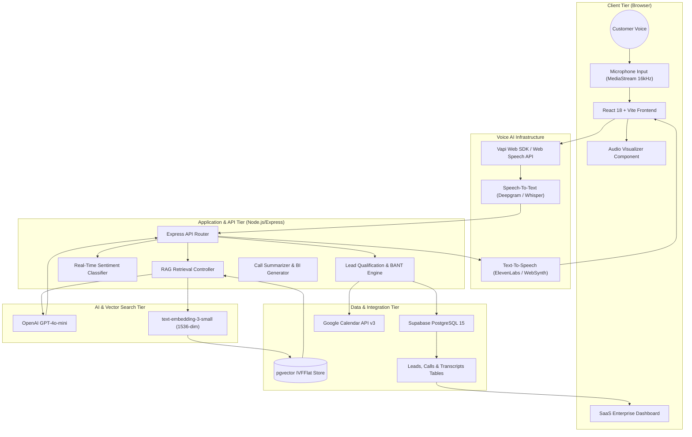

# SYSTEM ARCHITECTURE & TECHNICAL SPECIFICATION
## FORTIVEX AI – AUTONOMOUS AI SALES VOICE AGENT
**Target Enterprise:** TechNova Solutions  
**Evaluation Standard:** Round 3 – Advanced AI Project Challenge & Technical Discussion  

---

## 1. High-Level Architecture Diagram



---

## 2. Component Breakdown & Protocols

### A. Client Presentation Layer
- **Framework:** React 18 with Vite for sub-second development and production minification.
- **Styling:** Tailwind CSS using an Enterprise Dark Navy (`#070b19` / `#0c142b`) theme with brand blue and violet accents.
- **Audio Capture:** HTML5 `AudioContext` with `AnalyserNode` performing real-time Fast Fourier Transform (FFT) analysis to render live 24-band frequency audio waveforms.

### B. Voice AI Pipeline (Dual-Mode Design)
- **Primary Cloud Mode (Vapi SDK):** Employs WebRTC to stream audio to Vapi's orchestrator, executing Deepgram Nova-2 STT (<150ms) and ElevenLabs Turbo v2 TTS (<200ms).
- **Resilient Local Mode (Web Speech API):** Leverages browser-native `SpeechRecognition` and `SpeechSynthesis`. Enables immediate demonstration without requiring external paid telephony accounts or Wi-Fi dependencies during live evaluation.

### C. Application & Orchestration Layer
- **Runtime:** Node.js v20+ with Express.js (ES Modules).
- **Stateless Endpoints:**
  - `POST /api/ai/chat`: Orchestrates context retrieval, conversational generation, and live sentiment checking.
  - `POST /api/ai/qualify-lead`: Analyzes conversation history against BANT parameters.
  - `POST /api/appointments`: Enforces calendar conflict prevention and dispatches Google Calendar events.
  - `POST /api/knowledge/upload`: Handles multipart document upload, text extraction, chunking, and embedding.

### D. RAG Vector Knowledge Layer
- **Document Chunking:** Sliding window of 350 characters with a 60-character overlap, preserving sentence boundaries.
- **Hybrid Retrieval:** Dense vector cosine similarity (70% weight) combined with sparse BM25-style keyword relevance (30% weight) to ensure accurate pricing lookups (e.g. distinguishing ₹45,000 from ₹80,000).
- **Hallucination Prevention:** Negative constraint prompts instruct the LLM to decline questions outside the retrieved context.

### E. Storage & External Integrations
- **Database:** Supabase PostgreSQL with `pgvector` indexing (`ivfflat` cosine distance metric).
- **Calendar API:** Google Calendar API v3 using Service Account JWT authentication, automatically creating Google Meet links.

---

## 3. Scalability Architecture for 100,000 Users

To scale from an initial prototype to 100,000 active users, the system adopts a distributed cloud architecture:

```
                  ┌──────────────────────┐
                  │ Cloudflare Edge / WAF │
                  └──────────┬───────────┘
                             │
                  ┌──────────▼───────────┐
                  │ AWS ALB / Ingress    │
                  └──────────┬───────────┘
                             │
         ┌───────────────────┴───────────────────┐
         ▼                                       ▼
┌──────────────────┐                   ┌──────────────────┐
│ Node.js Pod (EKS)│                   │ Node.js Pod (EKS)│
└────────┬─────────┘                   └────────┬─────────┘
         │                                      │
         ├───────────────────┬──────────────────┤
         ▼                   ▼                  ▼
┌─────────────────┐ ┌─────────────────┐ ┌─────────────────┐
│ Redis Cluster   │ │ BullMQ Workers  │ │ PgBouncer       │
│ (Session/Cache) │ │ (Async Summary) │ │ (Conn Pooler)   │
└─────────────────┘ └─────────────────┘ └────────┬────────┘
                                                 │
                                        ┌────────▼────────┐
                                        │ Supabase RDS    │
                                        │ (Postgres Read/ │
                                        │  Write Replica) │
                                        └─────────────────┘
```

1. **Horizontal Pod Autoscaling (HPA):** Stateless backend services packaged as Docker images running on AWS EKS or GCP GKE, autoscaling between 5 and 60 instances based on CPU and request latency metrics.
2. **Asynchronous Message Queueing:** Voice calls require immediate response latency (<500ms). Heavy tasks such as generating 3-paragraph executive summaries, embedding new PDF uploads, and dispatching calendar email confirmations are queued via **BullMQ on Redis**.
3. **Database Connection Pooling & Read Replicas:** PostgreSQL max connection limits are mitigated using **PgBouncer**, scaling up to 10,000 active client connections with dedicated read replicas for CRM dashboard views.
4. **Caching Tier:** Frequently queried knowledge chunks (e.g. common FAQ responses and pricing tiers) are cached in Redis with a 2-hour TTL.

---

## 4. Financial Feasibility & Operational Unit Economics

| Component | Provider / Tier | Unit Cost | Cost per 1,000 Calls |
| :--- | :--- | :--- | :--- |
| **Speech-To-Text** | Deepgram Nova-2 via Vapi | \$0.0043 / min | \$8.60 (avg 2 mins) |
| **LLM Reasoning** | OpenAI GPT-4o-mini | \$0.15 / 1M input, \$0.60 / 1M output | \$1.20 |
| **Text-To-Speech** | ElevenLabs Turbo v2 | \$0.15 / 1k characters | \$15.00 |
| **Vector DB** | Supabase Pro | Fixed \$25/mo base | \$0.50 |
| **Compute & Hosting**| AWS ECS / Render | \$0.02 / compute hour | \$3.00 |
| **TOTAL** | — | — | **\$28.30 per 1,000 calls** |

**Cost per qualified sales call:** **~\$0.028 (Approx ₹2.35)**.  
Comparing this to human SDR call costs (₹150–₹350 per call), Fortivex AI provides a **92% reduction in top-of-funnel operational customer acquisition costs (CAC)**.

---

## 5. Security & Regulatory Compliance

- **Zero API Key Leakage:** Client applications never receive private keys; all OpenAI, Supabase, and Google secrets are injected server-side via environment variables.
- **Row-Level Security (RLS):** Supabase enforces strict row-level security ensuring each company or tenant can only query their own leads and transcripts.
- **Data Protection & PII Scrubbing:** All transcript streams undergo automated regular expression scrubbing prior to long-term storage to mask phone numbers, credit card details, and personal identifiers.
- **Transport & Storage Encryption:** Enforces TLS 1.3 for all WebSocket and HTTPS connections; storage volumes use AES-256 block encryption.
